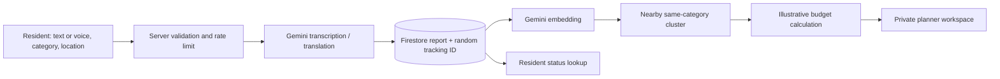

# How Vajra works

Vajra has two views of the same idea. The public planning studio contains invented examples so anyone can explore a budget without seeing citizen reports. The live workspace shows reports submitted to a particular Firebase project and is protected by a planner passcode.

## The path of a report



1. The resident describes a problem in up to 3,000 characters, chooses an infrastructure category, and marks coordinates inside India's broad geographic bounds. A voice note can be transcribed first; the resident can edit that transcript before submitting.
2. A server route validates the input and applies shared Firestore-backed rate limits. Gemini translates the description into English for comparison. When a photo is supplied, Gemini checks whether it appears relevant to the report. It does **not** authenticate the image or confirm the problem on the ground.
3. Firestore saves the report with a random, 20-character document ID. That ID is the resident's private receipt. A background step requests an embedding and compares the report with existing hotspots in the same category.
4. A report joins a hotspot when it is within 2 km and its embedding cosine similarity is at least 0.78. Otherwise it starts a new hotspot. These values are prototype choices, not field-validated accuracy claims.
5. A Firestore transaction updates the cluster and recalculates the scenario. The resident's status page reads limited information by receipt ID. The live planner sees the broader report and hotspot lists after signing in.

If the background step fails after a report is saved, the report is marked for retry. The planner workspace can retry pending work. A received report is not silently presented as a completed cluster.

## What the budget result means

A hotspot needs **at least two related reports** before it can qualify for the scenario. That is corroboration of a *description*, not proof that two distinct people reported it. One person could submit twice; Vajra currently has no identity verification or anti-coordination system.

For each hotspot, the score is:

```text
category weight × related report count × recency factor
```

The recency factor falls over 90 days and never drops below 0.5. The app sorts hotspots by score, then includes each qualifying hotspot if its fixed illustrative cost fits the remaining budget. It skips a cost that does not fit and continues down the list. The calculation is deterministic and respects the budget cap, but it is a priority-first heuristic, not a mathematically optimal public investment plan.

| Category | Weight | Illustrative cost (₹ lakh) |
| --- | ---: | ---: |
| Water supply | 10 | 15 |
| Health facilities | 9 | 25 |
| Sanitation | 8 | 12 |
| Drainage | 7 | 10 |
| Roads | 6 | 20 |
| Waste collection | 5 | 8 |
| Public transport | 4 | 18 |
| Other infrastructure | 3 | 10 |
| Streetlights | 2 | 5 |

These weights and costs were made for the demo. They are not tender rates, scheme rules, or government estimates. A real planner would need a field inspection, asset ownership, jurisdiction, scope, engineering estimate, existing project register, and local budget authority before making a decision. “Funded” in stored scenario data and “Included” on screen mean only **included in this illustrative calculation**.

## What is stored

| Collection or item | Purpose |
| --- | --- |
| `reports` | Submitted text, category, coordinates, translated text, timestamps, processing state, and linked hotspot ID |
| `hotspots` | Cluster category, centroid, related-report count, embedding, score, and scenario status |
| `budget_pool/current` | Current illustrative budget, allocation total, report count, and revision |
| `_rate_limits` | Time-windowed counters for intake, sign-in, tracking, voice, and AI usage; documents are not automatically deleted |
| `_whatsapp_*` | Optional webhook deduplication and short-lived sessions; unused without Meta credentials |

Optional image and audio bytes are sent to Gemini for that request; the app does not save those bytes as public assets or Firestore fields. Report text and coordinates **are** saved in Firestore. There is currently no resident deletion request flow or automatic retention period, so do not use this prototype to collect sensitive complaints or personal identifiers.

The public tracking endpoint reveals only category, status, creation time, processing state, a limited photo-relevance result, and the number of related reports. Anyone holding the receipt ID can view that limited status. Treat the ID as private.

The demand-signal JSON export contains category, coordinates, report count, score, and clearly labeled illustrative budget context. It does not include citizen text or media. Its `vajra-open-demand-v1` schema is an example for interoperability, not a live government data exchange.

## Access and security

- Firestore browser rules deny all direct reads and writes. Server routes use the Firebase Admin SDK and validate what they accept or return.
- Planner sign-in uses a passcode, an HTTP-only signed cookie, and origin checks for writes. The cookie lasts eight hours. This is appropriate only for a small controlled pilot; a real agency needs individual accounts, role-based access, and audit logs.
- Intake, voice, login, tracking, planning writes, and AI calls have shared Firestore rate counters. Uploads and JSON bodies are bounded in size.
- WhatsApp is optional. The current deployment has no Meta credentials, so its webhook does not process messages. If enabled later, the webhook checks Meta's signature and sender rate limits.

Read [Getting started](GETTING_STARTED.md) for the local credential setup and [Deployment](DEPLOYMENT.md) for hosting checks.

## India-specific considerations

The UI supports English, Hindi, and Telugu text. Gemini can process other languages, but quality is not yet measured by language, dialect, noise level, or device. The [MoSPI telecom survey](https://www.mospi.gov.in/uploads/blogpdfs/1766047952452-SOU03_EnSD_MOSPI%20%281%29.pdf) describes a rural–urban difference in household internet access; access alone also does not guarantee confident participation. A real pilot should compare reporting rates with population or household denominators and offer assisted or offline intake.

The public studio's eight places, household counts, and scheme-alignment notes are synthetic. Vajra does not yet join district-authorized demographic, infrastructure inventory, or investment data. [DARPG's grievance assessment](https://darpg.gov.in/sites/default/files/GRAI_2023.pdf) also shows that Indian public grievance systems already use AI analytics; Vajra's proposed addition is an explainable budget scenario and a resident feedback loop, not a claim to replace those systems.

The pilot is capped at 200 reports and 200 hotspots so clustering and allocation remain within its current transaction design. Beyond that, data must be partitioned by district, candidate search indexed, processing put on a durable queue, planner identity strengthened, and the policy tested with residents and officials. The [hackathon notes](hackathon-submission.md) list the measurements that would make those claims credible.

## API at a glance

| Route | Access | Use |
| --- | --- | --- |
| `POST /api/reports` | Public, rate-limited | Save a validated report and return a tracking ID |
| `POST /api/transcribe` | Public, rate-limited | Turn a short voice note into editable text |
| `GET /api/status/:id` | Anyone with the ID | Return limited status |
| `GET/POST/DELETE /api/auth` | Public sign-in and session actions | Check, create, or clear planner session |
| `GET /api/reports` and `GET /api/hotspots` | Planner | Read live summary lists |
| `GET/PUT /api/budget` | Planner | Read or save the illustrative budget |
| `POST /api/process` | Planner | Retry processing or recalculate |
| `POST /api/briefing` | Planner | Draft a short Gemini briefing for review |
| `GET/POST /api/whatsapp` | Optional Meta webhook | Disabled until configured |

This is a guide to the current implementation, not a stable public API contract.
