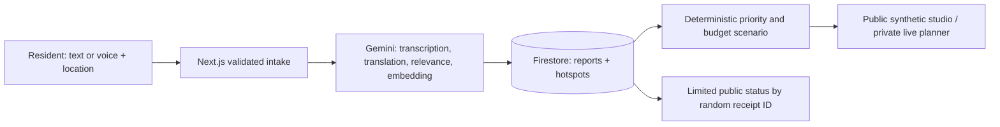

# Vajra — Track 1 submission notes

**Two-line description:** Vajra turns multilingual citizen reports about local infrastructure into nearby, corroborated demand signals. A transparent planning studio lets people test which needs fit an illustrative budget and lets a resident check the status of a report.

The [Build with AI: Code for Communities brief](https://hack2skill.com/event/codeforcommunities2) asks Track 1 teams to demonstrate inclusive text, voice or messaging intake; Google AI; demographic, infrastructure and investment context; and a path to India-scale use. Vajra is a working **free-tier pilot**, with voice/text intake and Gemini analysis. WhatsApp is optional and disabled without Meta credentials. The eight-state public scenario and its household counts are synthetic, so it should be pitched as a planning demonstration, not as an evaluated national dataset.

## Architecture for the demo

The current implementation has a 200-report/200-hotspot transaction cap. A national version would partition by district, retrieve indexed candidates, process through a durable queue, and audit each allocation policy with local officials. The live [methodology page](https://vajra-wheat.vercel.app/methodology) names those boundaries; it does not claim national throughput.

## What to show judges in 3–5 minutes

1. **0:00–0:30 — Problem.** A complaint can be heard without becoming an understandable investment signal. Existing grievance systems already use AI; show why a transparent budget scenario and feedback loop add value rather than claiming to replace them. [DARPG](https://darpg.gov.in/sites/default/files/GRAI_2023.pdf).
2. **0:30–1:30 — Resident flow.** Switch to Hindi or Telugu, show voice/text input and an India location, submit a clearly marked test issue, and record the receipt ID. Explain that photos indicate relevance only, not authenticity.
3. **1:30–2:15 — Signal.** Show the status page and the requirement for two related reports before a need can qualify. Mention category, 2 km proximity and 0.78 embedding similarity as testable prototype thresholds.
4. **2:15–3:30 — Planning studio.** Explore the synthetic list/map, move the illustrative budget slider to zero and back, open a detail card, and export the open demand JSON. State that “included” is a scenario result, never government approval.
5. **3:30–4:30 — India fit and limits.** Explain assisted/offline intake, local language testing, and the rural–urban participation gap. [MoSPI telecom survey](https://www.mospi.gov.in/uploads/blogpdfs/1766047952452-SOU03_EnSD_MOSPI%20%281%29.pdf). Show the methodology and pilot capacity.

Use only synthetic reports in a public recording. Do not show the planner passcode, service account, API key, or private citizen text.

## Suggested 11-slide deck

1. The local infrastructure decision problem
2. Who is missed by digital-only reporting in India
3. The resident experience
4. Multilingual and voice handling with Gemini
5. Nearby semantic clustering and corroboration
6. Transparent priority score
7. Illustrative constrained-budget scenario
8. Citizen status and accountable feedback
9. Architecture and data/security boundaries
10. Pilot evaluation: quality, latency, participation and fairness
11. Limitations, district-scale roadmap and the ask

## Evidence to collect during a real pilot

| Question | Measure | Required validation |
| --- | --- | --- |
| Can residents submit? | Completion rate, median/p95 time, failure reasons | Test different devices, weak connections and assisted intake |
| Is language support useful? | Human-rated transcription and translation accuracy per language | Bilingual reviewers and noisy real-world audio |
| Are clusters trustworthy? | Pairwise precision and recall, false merges/splits | Manually labeled nearby similar and unrelated reports |
| Does the planner help? | Time to triage and scenario reproducibility | Compare with a manual workflow on the same cases |
| Is participation equitable? | Reports by area/language divided by population or households served | Authorized district denominators and offline outreach counts |
| Does the budget hold? | Allocated amount at or below scenario cap on every run | Automated policy tests and planner audit |

No impact, accuracy, beneficiary, or savings number is established by the current demo. For real deployment, district agencies must validate asset ownership, field conditions, cost estimates, scheme eligibility, and duplicate works. Jurisdiction matters: for example, [Jal Jeevan Mission](https://jaljeevanmission.gov.in/) concerns rural household water, [AMRUT](https://amrut.gov.in/) is an urban mission, and [PMGSY](https://pmgsy.nic.in/) concerns eligible rural roads.

## Submission checklist

The event page calls for a GitHub repository, live link, a 3–5 minute demonstration video, a 10–12 slide deck, and a brief description. Verify the event portal's current submission deadline and required form fields before uploading. The connected and tested live link is **https://vajra-wheat.vercel.app**.
